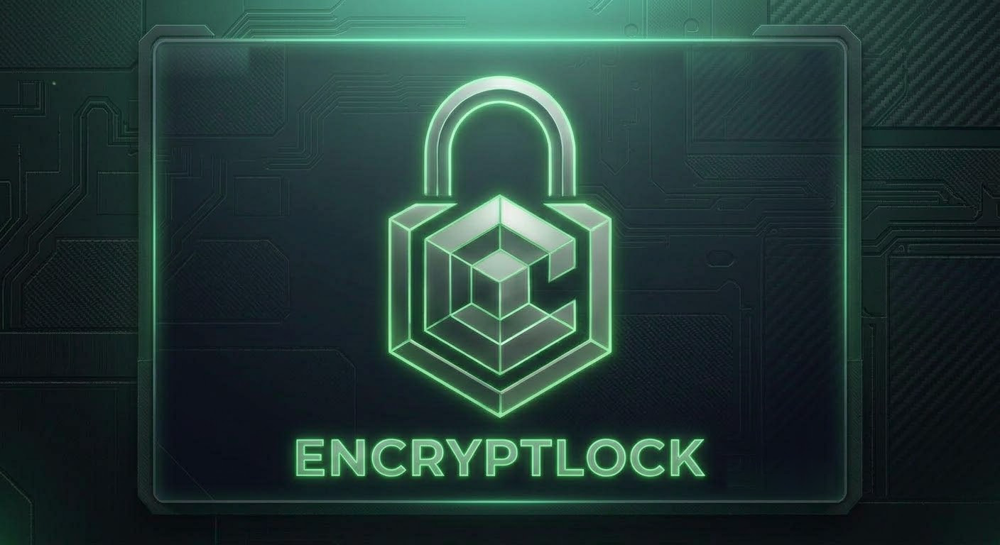

<h1 align="center">New blockchain. New era.</h1>

<b>Built by one developer with AI. EncryptLock is a new blockchain where ordinary computers keep the network running and get paid in LOCK. No mining rigs. No big power bills. And nobody loses their coins.</b>

  <a href="https://encryptlock.pages.dev"><b>🌐 encryptlock.pages.dev</b></a>

  <a href="https://github.com/filipejardim/encryptlock-downloads/releases/latest/download/EncryptLock-Windows.exe"><b>⬇️ Download for Windows</b></a>
  &nbsp;&nbsp;·&nbsp;&nbsp;
  <a href="https://github.com/filipejardim/encryptlock-downloads/releases/latest/download/EncryptLock-Android.apk"><b>⬇️ Download for Android</b></a>

---

## Why EncryptLock

| | |
|---|---|
| 💻 **Your PC earns LOCK** | Tap *"Make this computer a blockchain LockKeeper"* and leave it on. Switching off never costs you anything. |
| ↩️ **Mistakes come back** | Every transfer must be accepted within 1 hour. Wrong address? The money returns by itself. |
| 🛡️ **Theft gets stopped** | Second-device approval, daily limits and a *"Wasn't me"* button. |
| 👨‍👩‍👧 **Your family inherits** | Choose your heirs inside the network. Your coins never die with you. |
| 🏦 **Sovereign Vault** | Big savings get a 7 to 365 day delay on withdrawals, so you can cancel a theft in time. |
| 🗳️ **1 computer = 1 vote** | Checked with the PC's security chip (TPM 2.0). Cloud servers can't take over. |
| ⚛️ **Post-quantum** | Every transaction is signed twice, once with a post-quantum signature (ML-DSA, NIST standard). |
| 📉 **Anti-inflation: 40,000,000 LOCK, never more** | 38,799,000 LOCK released over the first 30 years, halving every 5 years. Then the everlasting reserve of 800,000 LOCK: what is left halves every 30 years, so new LOCK keeps arriving in ever smaller amounts for about 1,440 years. No vote can change it. |

**Full transparency:** the founder received 1% (400,000 LOCK) at the start, public on the chain since block 1. No pre-sale, no investors, no private deals.

**Built by one founder working with AI.** 🇵🇹

## Read more

- **How it works, all the rules:** [White paper](white-paper.md) (Portuguese)
- **Privacy:** [privacy.md](privacy.md)
- **The code:** private, to protect the project from copies. Every rule is described in the white paper.

## Install

- **Windows:** open `EncryptLock-Windows.exe`. If Windows says *"Windows protected your PC"*, click **More info → Run anyway**.
- **Android:** open `EncryptLock-Android.apk` and allow installing from this source. On Samsung, if *Auto Blocker* stops it, tap **More details → Install anyway**.

The apps update themselves: when a new version is out, they show **Update**.

## Safety

⚠️ EncryptLock will **never** send you a message first and will **never** ask for your 24 words. Anyone who does is a scammer.
Only download from this page or from [encryptlock.pages.dev](https://encryptlock.pages.dev).

---

### 🇵🇹 Em português

**O teu computador está ligado. Deixa-o ganhar.** O EncryptLock é uma blockchain nova em que computadores normais mantêm a rede e recebem LOCK. Sem mineração. Enganos que voltam para trás, roubos travados, herança para a família. Descarrega em **[encryptlock.pages.dev](https://encryptlock.pages.dev)**.

Nothing here is financial advice. LOCK's price is set only by people trading inside the app.
